# App Store Listing — Promises

Copy for App Store Connect, version 1.0. Numbers in parentheses are App Store
Connect's character limits; every field below fits within them.

## App Information

| Field | Value |
| --- | --- |
| Name (30) | Promises – Bible Verses |
| Subtitle (30) | Daily Bible promises & verses |
| Bundle ID | `com.tunnellight.Promises` |
| SKU | `promises-ios` |
| Primary category | Reference |
| Secondary category | Lifestyle |
| Age rating | 4+ (answer "None" to every content question) |
| Copyright | © 2026 Alex Therakathu |
| Privacy Policy URL | https://github.com/tunnellight392/promises_ios/blob/main/PRIVACY.md |
| Support URL | https://github.com/tunnellight392/promises_ios |
| Price | Free |

## Promotional Text (170)

> A promise from God's Word every day. Browse 18 topics like peace, fear,
> and hope, save favorites, and share beautiful verse cards — in English or
> Malayalam.

## Description (4000)

```
Start each day with a promise from God's Word.

Promises puts a hand-picked Bible verse in front of you every morning, set over a calm nature photograph. It's simple, quiet, and works completely offline — no account, no ads, no tracking.

PROMISE OF THE DAY
• A new promise every day, the same all day long
• Swipe left or right to read more, or tap shuffle for a surprise
• Beautiful nature backgrounds that change with every verse

BROWSE BY TOPIC
Find the words you need for what you're facing, across 18 topics:
Addiction & Freedom, Anxiety & Worry, Children, Comfort & Grief, Depression, Faith, Fear, Forgiveness, Gratitude, Guidance, Healing, Hope, Loneliness, Love, Peace, Salvation, Strength, and Trust.

SAVE YOUR FAVORITES
Tap the heart to keep a verse. Your favorites appear at the top of Browse, ready whenever you need them.

SHARE A VERSE
Share any promise as a ready-made picture card with the verse text, perfect for Messages, WhatsApp, or social posts.

ENGLISH AND MALAYALAM
Read in the World English Bible (WEB) or the Malayalam Sathyavedapusthakam (സത്യവേദപുസ്തകം, O.V.). Switch anytime in Settings.

DAILY REMINDER
Turn on a gentle notification to receive the promise of the day at the time you choose.

MAKE IT YOURS
• Light, dark, or system appearance
• Adjustable text size, with Dynamic Type support
• Serif, sans-serif, or monospaced fonts

PRIVATE BY DESIGN
Promises collects no data. Your favorites and settings stay on your device.

Works on iPhone and iPad.
```

## Keywords (100)

```
bible,verse,daily,scripture,devotional,christian,god,faith,hope,peace,malayalam,promise,jesus
```

## What's New (version 1.0)

```
Welcome to Promises! Read a Bible promise every day, browse by topic, save favorites, and share beautiful verse cards.
```

## App Privacy

| Question | Answer |
| --- | --- |
| Data collection | Data Not Collected |
| Tracking | No |

Feedback opens the user's own Mail app; nothing is sent by the app itself, so
it does not count as collection.

## App Review Information

| Field | Value |
| --- | --- |
| Sign-in required | No |
| Contact email | tunnellightt392@gmail.com |

Notes for the reviewer:

```
Promises needs no account and works fully offline. All verses are bundled in the app. The daily reminder is optional and can be turned on in Settings (… menu → Settings → Daily Promise). Sharing a verse opens the standard share sheet with a picture card and the verse text.
```

## Screenshots

Captured on iOS 27.0 simulators with a clean 9:41 status bar, full resolution
and unscaled, ready to upload.

| Device | App Store size | Resolution | Folder |
| --- | --- | --- | --- |
| iPhone 18 Pro Max | 6.9" display | 1320 × 2868 | `screenshots/iphone/` |
| iPad Pro 13-inch (M5) | 13" display | 2064 × 2752 | `screenshots/ipad/` |

Each folder has the same seven screens, in upload order:

| File | Screen |
| --- | --- |
| `01_today.png` | Promise of the Day — Matthew 11:28 (WEB), favorited |
| `02_browse.png` | Browse — Favorites group and topics |
| `03_topic.png` | A topic opened — Anxiety & Worry |
| `04_favorites.png` | Favorites |
| `05_settings.png` | Settings |
| `06_text_font.png` | Text & Font |
| `07_malayalam.png` | Promise of the Day in Malayalam (സത്യവേദപുസ്തകം) |

### iPhone

| | | | |
| --- | --- | --- | --- |
| 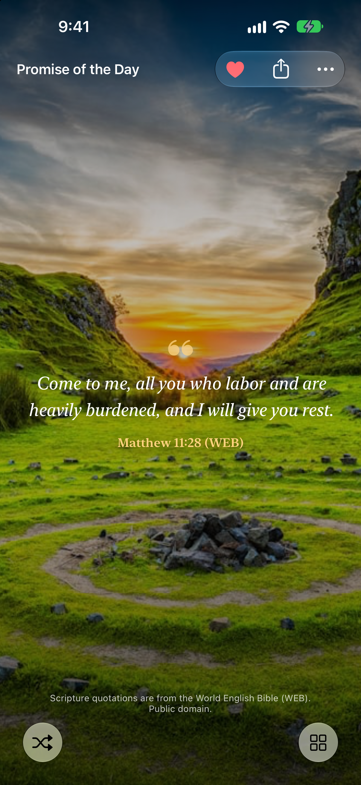 | 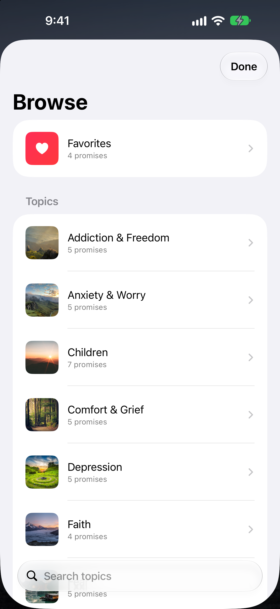 | 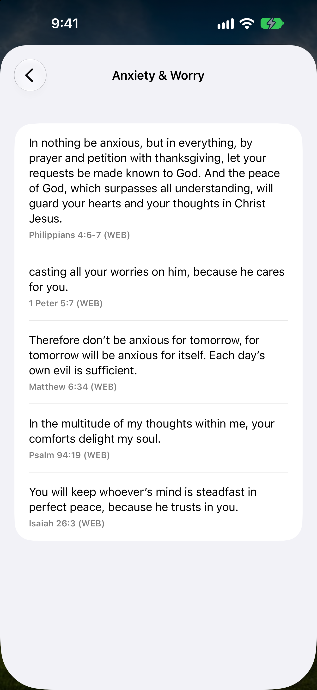 |  |
| 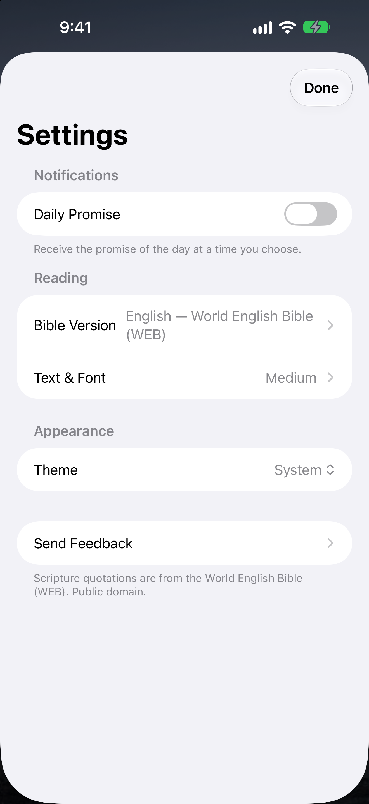 | 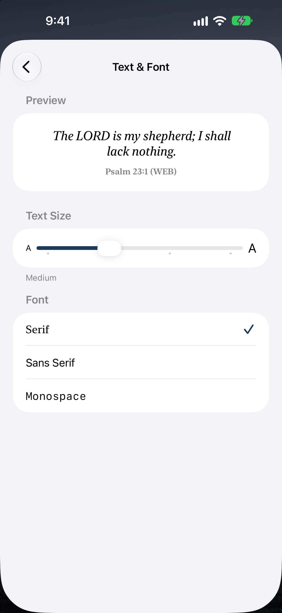 | 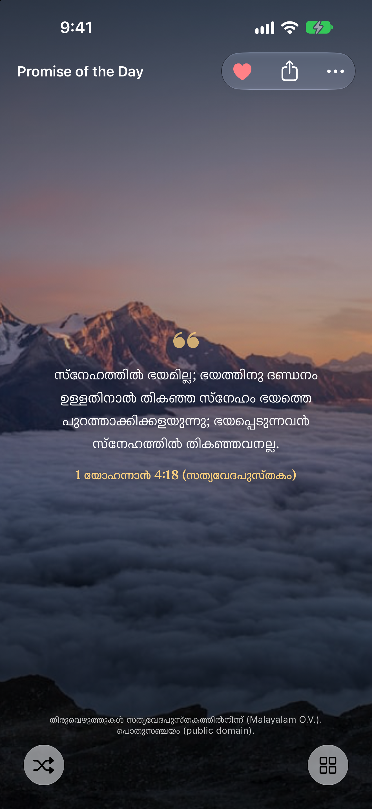 | |

### iPad

| | | | |
| --- | --- | --- | --- |
|  | 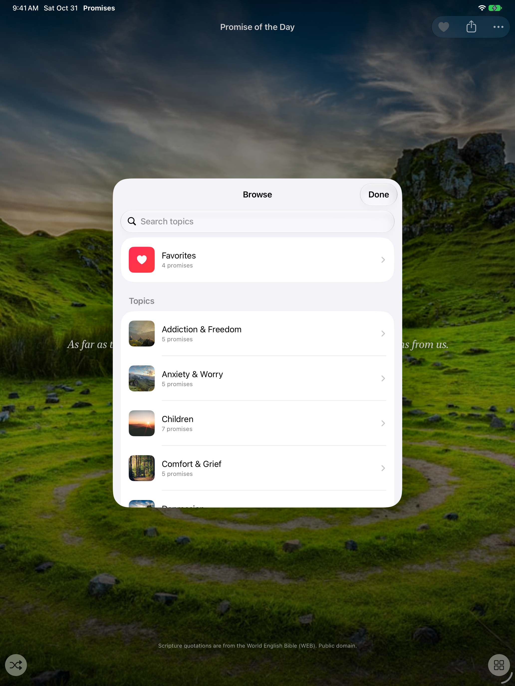 | 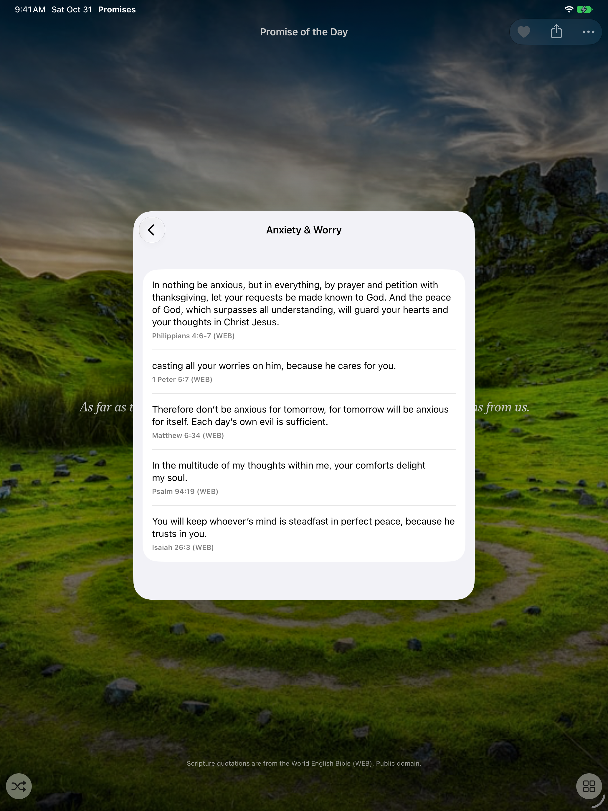 | 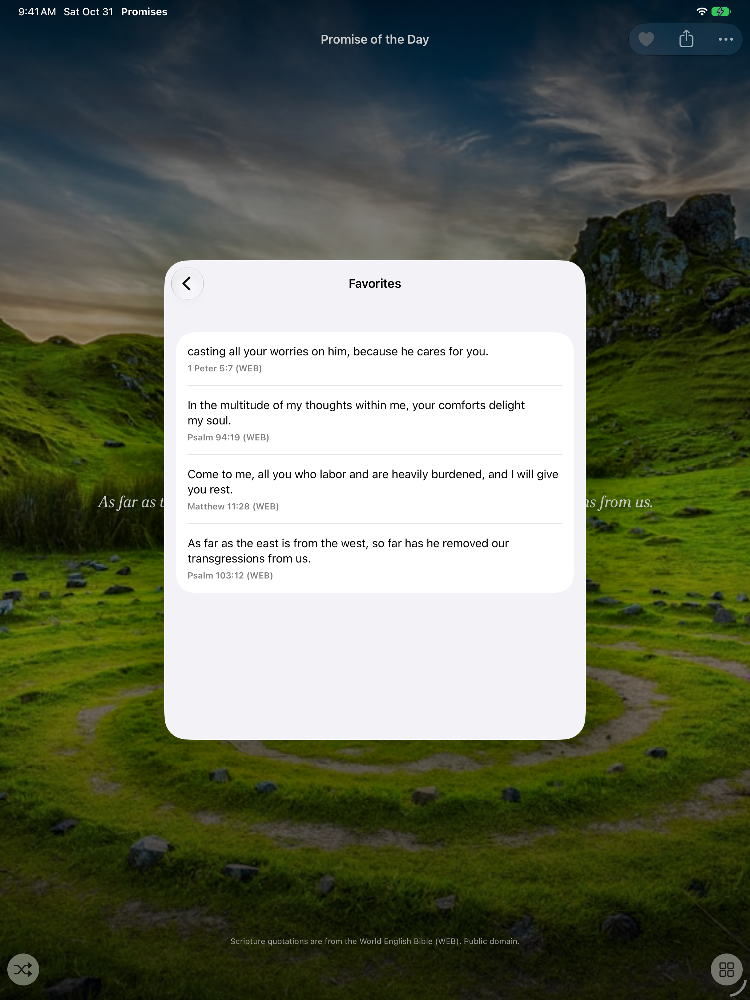 |
| 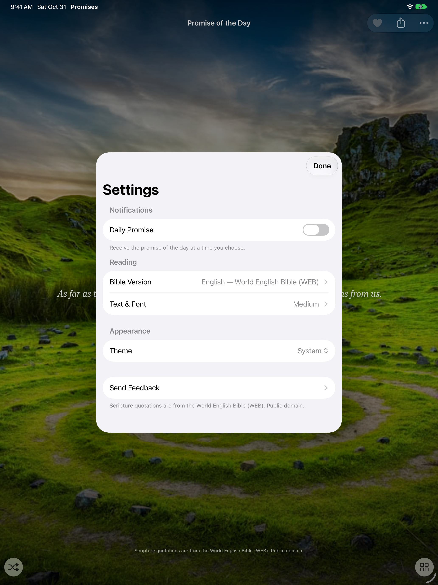 | 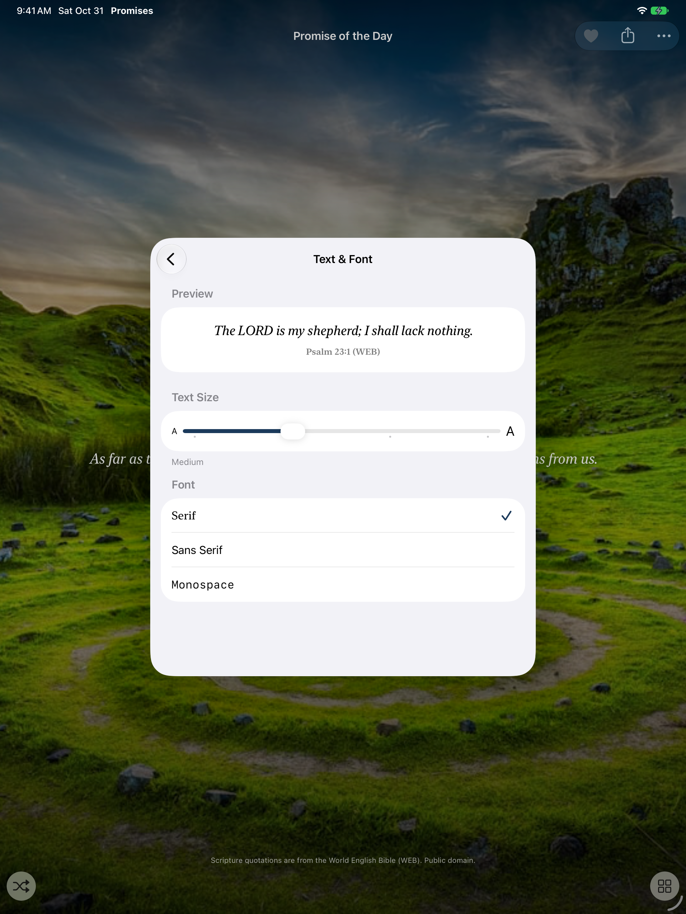 | 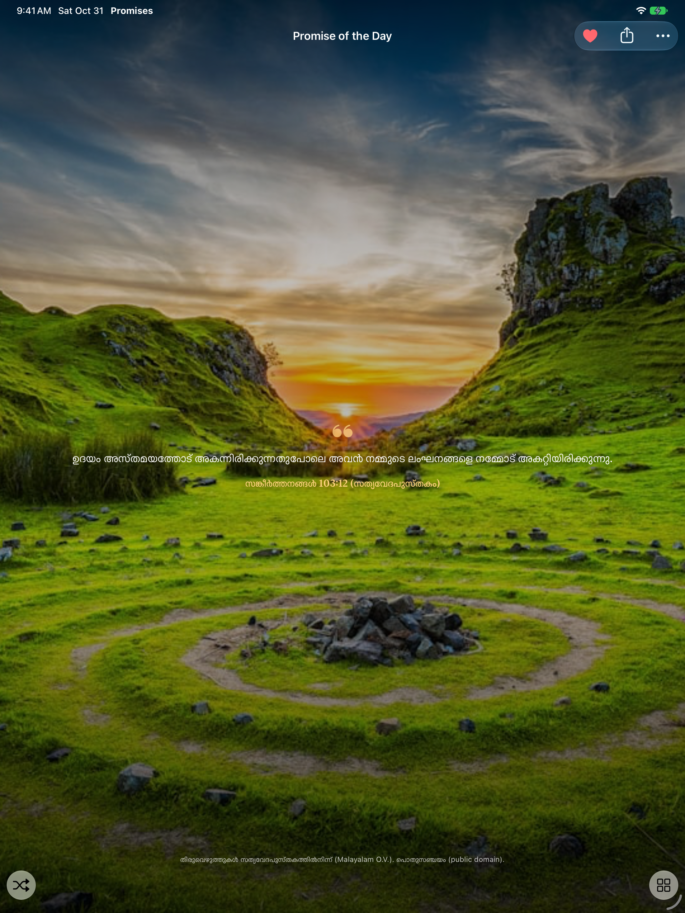 | |
